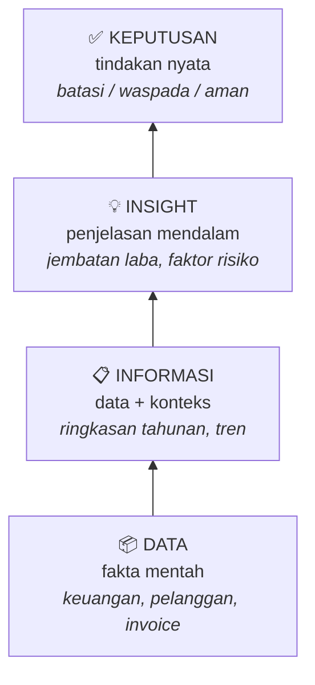
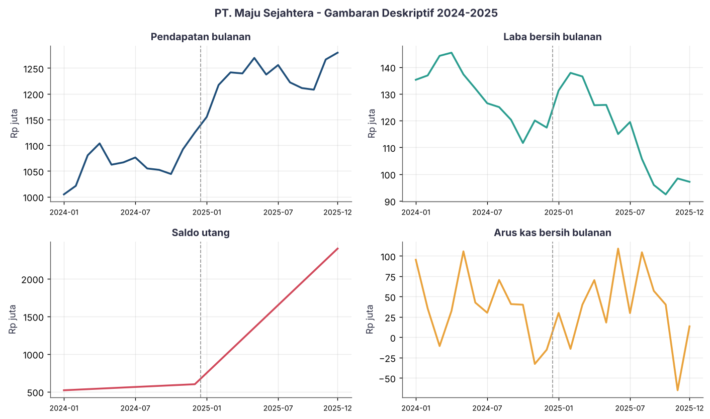
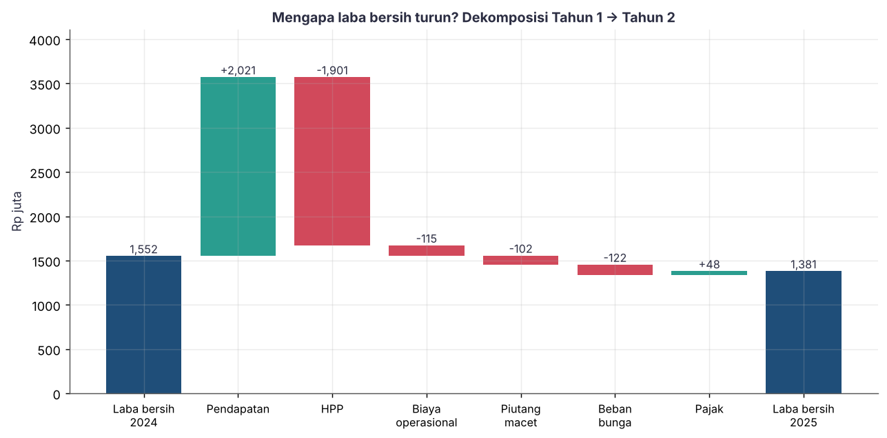
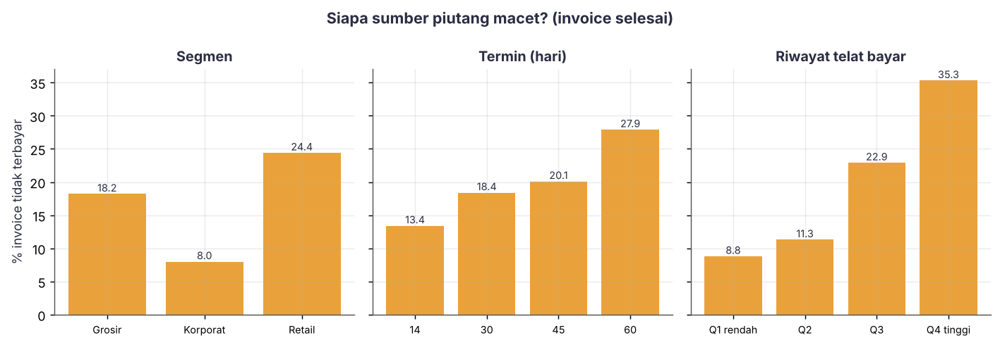
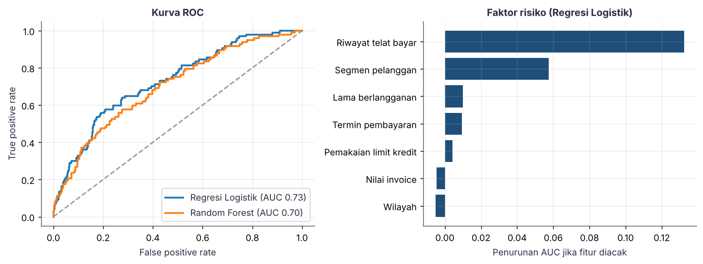
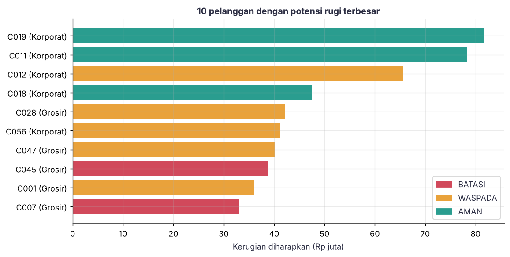

<div align="center">

# 📊 Dari Data Menjadi Keputusan
### Studi Kasus Analitik **PT. Maju Sejahtera**
*Descriptive → Diagnostic → Predictive → Prescriptive*


-2A9D8F)

**Mata Kuliah:** Make Sense of Data with Analytics and AI · **Sesi 1**
**Penulis:** Arrufi Andersone · **NPM:** G1A023090 · **Kelas:** B

</div>

---

## 📑 Daftar Isi
1. [Latar Belakang](#-latar-belakang)
2. [Studi Kasus](#-studi-kasus)
3. [Rumusan Masalah](#-rumusan-masalah)
4. [Tujuan](#-tujuan)
5. [Batasan Masalah](#-batasan-masalah)
6. [Kerangka Pendekatan](#-kerangka-pendekatan)
7. [Dataset](#-dataset)
8. [Struktur Proyek](#-struktur-proyek)
9. [Cara Menjalankan](#-cara-menjalankan)
10. [Hasil dan Pembahasan](#-hasil-dan-pembahasan)
11. [Keterbatasan dan Pengembangan Lanjut](#-keterbatasan-dan-pengembangan-lanjut)
12. [Kesimpulan](#-kesimpulan)

---

## 🎯 Latar Belakang

Pengambilan keputusan berbasis data tidak cukup dengan menampilkan angka. Materi **Sesi 1** menekankan bahwa **analitik** dan **AI** harus dikombinasikan: analitik menjelaskan *apa dan mengapa*, sedangkan AI/machine learning membantu *memprediksi dan merekomendasikan*. Proyek ini menerjemahkan materi tersebut menjadi alur kerja yang dapat dijalankan, dari data mentah sampai rekomendasi tindakan.

## 🏢 Studi Kasus

**PT. Maju Sejahtera** adalah perusahaan distribusi dengan sistem database yang kompleks. Seorang *data analyst* tidak perlu menghafal seluruh isi database; ia cukup menentukan **data mana yang relevan** untuk menjawab kebutuhan manajemen.

Fakta dari data dua tahun terakhir:

| Indikator | Kondisi |
|---|---|
| Revenue (pendapatan) | ⬆️ Naik |
| Net profit (laba bersih) | ⬇️ Turun **11%** |
| Utang | ⬆️ Naik tajam **300%** |
| Cash flow | ⬇️ Berkurang **Rp 1 juta** |

Manajemen bertanya: **"Apakah kondisi perusahaan baik atau buruk?"** Data deskriptif saja tidak mampu menjawabnya, sehingga dibutuhkan analisis bertingkat sampai ke keputusan.

## ❓ Rumusan Masalah

1. Apa yang sebenarnya terjadi pada kinerja keuangan PT. Maju Sejahtera dalam dua tahun terakhir? *(Descriptive)*
2. Mengapa pendapatan naik tetapi laba bersih turun dan utang melonjak? *(Diagnostic)*
3. Invoice atau piutang mana yang berpotensi tidak terbayar? *(Predictive)*
4. Tindakan apa yang sebaiknya diambil manajemen terhadap pelanggan berisiko? *(Prescriptive)*

## 🎓 Tujuan

- Menerapkan **empat tingkat analitik** pada satu kasus bisnis yang utuh.
- Memperlihatkan perjalanan **Data → Informasi → Insight → Keputusan**.
- Menghasilkan kode yang **sederhana, dapat direproduksi, dan mudah dimodifikasi**.

## 🚧 Batasan Masalah

| # | Batasan |
|---|---|
| 1 | **Data sintetis.** Seluruh angka adalah simulasi (satuan Rp juta) yang dikalibrasi agar sesuai fakta materi. Bukan data perusahaan sungguhan. |
| 2 | **Periode:** Tahun 1 = 2024 dan Tahun 2 = 2025 (24 bulan). Invoice sejak 1 November 2025 berstatus *berjalan* (hasil belum diketahui). |
| 3 | **Ruang lingkup:** keuangan bulanan, 60 pelanggan, dan 2.200 invoice. Tidak mencakup stok, pengiriman, atau data pemasok. |
| 4 | **Prediksi** hanya untuk risiko invoice tidak terbayar, memakai model sederhana (Regresi Logistik dan Random Forest). |
| 5 | **Rekomendasi preskriptif** memakai aturan ambang dan asumsi dampak yang dapat diubah di `src/config.py`; ini bukan optimasi matematis penuh. |
| 6 | Hubungan **korelasi** pada data tidak dibuktikan sebagai **sebab-akibat** secara statistik. |
| 7 | Keputusan akhir tetap membutuhkan **penilaian manusia** (pengalaman dan konteks di luar data). |

## 🧭 Kerangka Pendekatan

### Piramida Data → Keputusan



### Empat Tingkat Analitik dan Implementasinya

| Tingkat | Pertanyaan | Implementasi di proyek | Modul |
|---|---|---|---|
| **Descriptive** | Apa yang terjadi? | Ringkasan tahunan dan tren bulanan | `src/descriptive.py` |
| **Diagnostic** | Mengapa terjadi? | Dekomposisi laba (profit bridge), rasio kunci, risiko per kelompok | `src/diagnostic.py` |
| **Predictive** | Apa yang akan terjadi? | Model klasifikasi invoice berisiko tidak terbayar | `src/predictive.py` |
| **Prescriptive** | Apa yang harus dilakukan? | Rekomendasi kebijakan kredit per pelanggan + estimasi manfaat | `src/prescriptive.py` |

Prosesnya **iteratif**: pemahaman bisnis → identifikasi data relevan → persiapan data → pemodelan → evaluasi → pelaporan.

## 🗂️ Dataset

Semua file dibuat otomatis oleh `src/data_generator.py` (seed tetap = hasil selalu sama).

| File | Isi | Baris |
|---|---|---|
| `data/keuangan_bulanan.csv` | Pendapatan, HPP, biaya operasional, bunga, laba, piutang, DSO, utang, arus kas | 24 |
| `data/pelanggan.csv` | Segmen, wilayah, lama berlangganan, limit kredit | 60 |
| `data/invoice.csv` | Transaksi invoice: nilai, termin, riwayat telat bayar, pemakaian limit, status, hasil | 2.200 |

Variabel target prediksi: `tidak_terbayar` (1 = gagal bayar). Fitur: lama berlangganan, nilai invoice, termin, riwayat telat bayar, pemakaian limit kredit, segmen, dan wilayah.

> **Kalibrasi skenario:** program memvalidasi otomatis bahwa pendapatan naik, laba bersih turun tepat 11%, utang naik tepat 300%, dan arus kas turun tepat Rp 1 juta. Jika tidak sesuai, program berhenti dengan pesan galat.

## 📁 Struktur Proyek

```
maju-sejahtera-analytics/
├── main.py                  # menjalankan seluruh alur
├── requirements.txt
├── README.md
├── src/
│   ├── config.py            # parameter skenario, ambang kebijakan, gaya grafik
│   ├── data_generator.py    # data sintetis
│   ├── descriptive.py       # tingkat 1
│   ├── diagnostic.py        # tingkat 2
│   ├── predictive.py        # tingkat 3
│   └── prescriptive.py      # tingkat 4
├── data/                    # dataset CSV (hasil generate)
└── outputs/
    ├── figures/             # grafik PNG
    ├── tables/              # tabel hasil CSV
    └── laporan_keputusan.md # laporan ringkas otomatis
```

## ▶️ Cara Menjalankan

```bash
# 1. Clone repositori
git clone https://github.com/Arrafi17/maju-sejahtera-analytics.git
cd maju-sejahtera-analytics

# 2. (Opsional) buat virtual environment
python -m venv .venv
source .venv/bin/activate        # Windows: .venv\Scripts\activate

# 3. Pasang dependensi
pip install -r requirements.txt

# 4. Jalankan
python main.py
```

Seluruh data, tabel, grafik, dan laporan akan dibuat ulang di folder `data/` dan `outputs/`. Waktu proses sekitar beberapa detik.

**Eksperimen cepat:** ubah `BATAS_TINGGI`, `BATAS_SEDANG`, atau `EFEK_KEBIJAKAN` di `src/config.py`, lalu jalankan ulang untuk melihat perubahan rekomendasi (analisis *what-if*).

---

## 📈 Hasil dan Pembahasan

### 1️⃣ Descriptive: *Apa yang terjadi?*

| Metrik (Rp juta) | Tahun 2024 | Tahun 2025 | Perubahan |
|---|---:|---:|---:|
| Pendapatan | 12.783,1 | 14.803,8 | **+15,8%** |
| Laba bersih | 1.552,0 | 1.381,3 | **−11,0%** |
| Utang (akhir tahun) | 600,0 | 2.400,0 | **+300%** |
| Arus kas bersih | 433,3 | 432,3 | **−1,0** (Rp 1 juta) |



**Pembacaan:** pendapatan tumbuh, tetapi laba menurun, utang membengkak, dan arus kas stagnan. Angka-angka ini **belum cukup** untuk menyatakan perusahaan "baik" atau "buruk", sehingga perlu naik ke tahap diagnostik.

### 2️⃣ Diagnostic: *Mengapa terjadi?*



| Rasio | 2024 | 2025 |
|---|---:|---:|
| Margin kotor | 28,47% | **25,39%** |
| Biaya operasional / pendapatan | 11,89% | 11,04% |
| Piutang macet / pendapatan | 0,49% | **1,12%** |
| Beban bunga / pendapatan | 0,53% | **1,28%** |
| DSO rata-rata (hari) | 39,8 | **50,2** |
| Margin bersih | 12,14% | **9,33%** |

**Insight:**
- Tambahan pendapatan **+Rp 2.021 juta** hampir seluruhnya terserap kenaikan **HPP (−Rp 1.901 juta)**. Pertumbuhan terjadi dengan margin yang menipis.
- **Biaya kredit** ikut menggerus laba: beban bunga (−122) dan piutang macet (−102) membesar seiring utang yang naik dan penagihan yang melambat (DSO naik ±10 hari).
- Biaya operasional justru membaik secara rasio, jadi bukan sumber masalah utama.

Siapa sumber piutang bermasalah?



Invoice **Retail** (24,4%), **termin 60 hari** (27,9%), dan pelanggan dengan **riwayat telat bayar tinggi** (35,3% pada kuartil teratas) paling sering gagal bayar.

### 3️⃣ Predictive: *Apa yang akan terjadi?*

Dua model dibandingkan pada 25% data uji (invoice berstatus *selesai*):

| Model | ROC-AUC | Avg Precision | Precision* | Recall* |
|---|---:|---:|---:|---:|
| **Regresi Logistik** ✅ | **0,728** | 0,418 | 0,406 | 0,443 |
| Random Forest | 0,700 | 0,395 | 0,387 | 0,423 |

<sub>*pada ambang risiko 0,30</sub>



Faktor risiko terpenting: **riwayat telat bayar** (jauh di atas yang lain), lalu **segmen pelanggan**, lama berlangganan, dan termin. Dari **200 invoice berjalan**, **45** diprediksi berisiko (probabilitas ≥ 0,30). Daftarnya ada di `outputs/tables/05_prediksi_invoice_berjalan.csv`.

> ⚠️ Performa model tergolong **sedang** (AUC ≈ 0,73). Model dipakai sebagai alat prioritas, bukan penentu tunggal.

### 4️⃣ Prescriptive: *Apa yang harus dilakukan?*

Probabilitas per invoice dijumlahkan menjadi **kerugian diharapkan per pelanggan**, lalu diterjemahkan menjadi tindakan:

| Rekomendasi | Aturan (rata-rata prob.) | Tindakan | Pelanggan | Eksposur (Rp juta) | Rugi diharapkan (Rp juta) | Manfaat bersih (Rp juta) |
|---|---|---|---:|---:|---:|---:|
| 🔴 **BATASI** | ≥ 0,30 | Wajib bayar di muka (DP 50%), tanpa kredit baru | 17 | 654,9 | 259,3 | 139,9 |
| 🟠 **WASPADA** | 0,15 – 0,30 | Turunkan limit 30%, termin maks. 30 hari | 25 | 2.328,0 | 489,2 | 112,1 |
| 🟢 **AMAN** | < 0,15 | Pertahankan kebijakan | 16 | 3.869,2 | 311,9 | 0 |



**Estimasi manfaat bersih kebijakan: ± Rp 252 juta**, yaitu kerugian yang dihindari dikurangi margin penjualan yang hilang akibat pembatasan (asumsi dampak ada di `src/config.py`).

### 🧠 Dari Insight ke Keputusan

Materi menyebut langkah **insight → keputusan** sebagai yang tersulit karena butuh pengalaman di luar data. Proyek ini menunjukkan alasannya. Dua pelanggan korporat (C019 dan C011) punya **kerugian diharapkan tertinggi** namun berstatus *AMAN* karena probabilitas gagal bayarnya rendah. Apakah tetap dibiarkan, atau diminta jaminan karena nilainya besar? Itu keputusan manajemen yang bergantung pada hubungan bisnis, bukan sekadar output model.

---

## 🔬 Keterbatasan dan Pengembangan Lanjut

- Data sintetis; hasil nyata akan berbeda dan perlu validasi dengan data asli.
- Model belum dikalibrasi dan belum diuji pada data lintas waktu (*time-based split*).
- Efek kebijakan (pengurangan rugi dan kehilangan penjualan) adalah **asumsi**, idealnya diuji lewat A/B test atau pilot.
- Pengembangan: tuning model, penjelasan prediksi dengan SHAP, dashboard interaktif (Streamlit), dan optimasi limit kredit.

## ✅ Kesimpulan

1. Kenaikan pendapatan **tidak otomatis** berarti sehat: margin menipis, biaya kredit naik, dan utang membengkak.
2. Setiap tingkat analitik menjawab pertanyaan yang berbeda dan saling membangun, dari *apa* → *mengapa* → *apa selanjutnya* → *apa yang dilakukan*.
3. Sesuai pesan materi, analisis yang baik bukan soal model paling canggih, tetapi **ketelitian memahami data, kejujuran mengevaluasi hasil dugaan, dan keberanian mengambil keputusan yang tepat**.

---

<div align="center">

*Dibuat untuk tujuan pembelajaran · Sesi 1 · Arrufi Andersone (G1A023090) · Kelas B*

</div>
